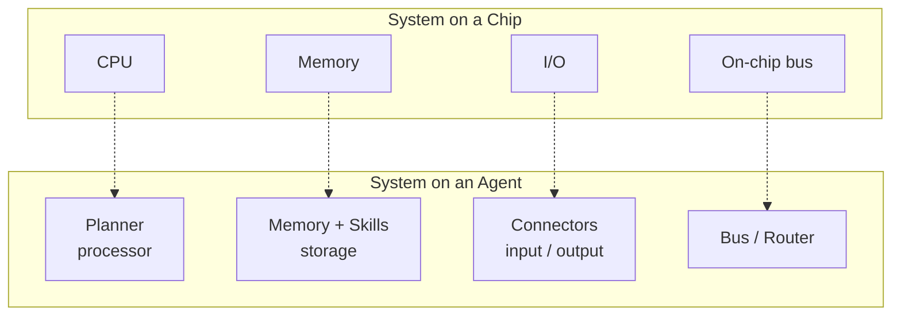

# System on an Agent: plugin edition

<!-- mcp-name: io.github.fitzyracing1/system-on-an-agent-plugin -->

> This is the **plugin / MCP-server edition** of [System on an Agent](https://github.com/fitzyracing1/system-on-an-agent). It carries the full history of that repository plus a stdio MCP server, a Cursor plugin manifest, and MCP Registry metadata, so it can be submitted to the xAI plugin marketplace.

A system on a chip puts a CPU, memory, I/O, and a bus on one piece of silicon. A **system on an agent** puts the same parts into one agent:

| System on a Chip | System on an Agent |
| --- | --- |
| CPU | Planner (the processor) |
| Memory | Memory and skills (storage) |
| I/O | Connectors (input and output) |
| On-chip bus | Bus / router |

The core is only those four parts. Optional add-ons plug in later through a manifest and hook interface, without changing the core.



## Core

- **Planner.** Takes a goal, builds a plan, and runs it step by step. The default planner is deterministic and rule-based; no language model is required. An optional `LLMProvider` interface can be attached later. If the model fails to return a valid plan, the rule-based planner is the fallback.
- **Memory and skills.** Working memory holds short-lived values for the current run. Long-term memory stores facts (optionally persisted as JSON). The skill library is a set of reusable named procedures the planner can run.
- **Connectors.** A pluggable I/O surface. This repository ships a local file connector and an echo (mock) connector.
- **Bus / router.** Routes messages between the planner, memory, skills, and connectors, and fires add-on hooks around each step.

## Quickstart

Requires Python 3.10 or newer.

```bash
python -m pip install -e ".[dev]"
soa skills list
soa connectors list
soa run "echo hello from system on an agent"
pytest
```

`soa run` prints the goal, the plan, and the output. Add `--json` for a machine-readable report. Built-in goal forms include:

- `echo hello` / `say hello` — send text through the echo connector
- `remember the sky is blue` — store a fact
- `recall sky` — look up facts
- `read path/to/file` and `write hello to path/to/file` — file connector
- `list skills` / `list connectors`
- Join steps with `then`: `echo hi then remember hi was said`

## Use as an MCP server

`soa mcp` (or `system-on-an-agent mcp`) serves the system over the Model Context Protocol on stdio. The server is built into the package: it needs no extra dependencies and opens no network sockets.

| Tool | What it does |
| --- | --- |
| `plan_goal` | Plan a goal with the rule-based planner and return the steps without running them. |
| `run_goal` | Plan and run a goal on the bus; returns the plan, each step result, and the output. |
| `memory_remember` | Store a fact (with optional tags) in long-term memory. |
| `memory_recall` | Look up facts by substring; an empty query returns all facts. |
| `list_skills` | List the skill library with descriptions and parameters. |
| `run_skill` | Run one named skill through the bus, e.g. `echo` with `{"text": "hi"}`. |
| `list_connectors` | List the registered connectors (`echo`, `file`). |

Options go before `mcp`:

- `--file-root DIR` confines the file connector to `DIR` (default: the working directory). Paths that escape it fail.
- `--memory-file PATH` persists long-term memory as JSON at `PATH` (default: in memory for the session).
- `--addon PATH` loads an optional add-on, as with `soa run`.

### Connect it to an MCP client

Run it straight from GitHub with [uv](https://docs.astral.sh/uv/):

```json
{
  "mcpServers": {
    "system-on-an-agent": {
      "command": "uvx",
      "args": [
        "--from",
        "git+https://github.com/fitzyracing1/system-on-an-agent-plugin",
        "system-on-an-agent",
        "mcp"
      ]
    }
  }
}
```

Or install it into a Python 3.10+ environment and point the client at the script:

```bash
python -m pip install "git+https://github.com/fitzyracing1/system-on-an-agent-plugin"
```

```json
{
  "mcpServers": {
    "system-on-an-agent": {
      "command": "system-on-an-agent",
      "args": ["--file-root", "/path/to/workdir", "--memory-file", "/path/to/memory.json", "mcp"]
    }
  }
}
```

This repository is also a Cursor plugin: [`.cursor-plugin/plugin.json`](.cursor-plugin/plugin.json) points at [`mcp.json`](mcp.json), the [skill](skills/system-on-an-agent/SKILL.md), and the [logo](assets/logo.svg). [`server.json`](server.json) describes the server in the [MCP Registry](https://github.com/modelcontextprotocol/registry) format.

### Test it locally

```bash
python -m pip install -e ".[dev]"   # adds pytest, ruff, and the official MCP Python SDK
ruff check src tests
pytest                              # tests/test_mcp_client.py starts the server and calls every tool
```

## Submitting to the xAI marketplace

The [Submit a plugin](https://x.ai/bot/marketplace/submit-a-plugin) form lists plugins for Grok Bot, Cursor, and Grok (coming soon). It takes an MCP server URL or a **public GitHub repository**, which this repository is (submit this plugin repository, not the upstream one). The form does not publish a manifest spec, so this repo follows the Cursor plugin format (`.cursor-plugin/plugin.json` + `mcp.json`) and MCP Registry `server.json` conventions. That is an assumption to confirm during review.

Done in the repo:

- [x] Working stdio MCP server with seven tools, tested through the official MCP client
- [x] Cursor plugin manifest, `mcp.json`, skill, and a square logo (`assets/logo.svg`, `assets/logo.png`)
- [x] `server.json` for the MCP Registry
- [x] MIT license, no secrets or required environment variables

Needs a person:

- [ ] **First and last name** of the submitter
- [ ] **Work email.** The form asks for a work email, so a personal Gmail may not pass review.
- [ ] **Organization name** and a unique lowercase **organization handle** (no spaces)
- [ ] **Website URL** (optional), e.g. `https://fitzyracing1.github.io/system-on-an-agent/`
- [ ] **Logotype URL**: a 1:1 SVG or PNG with a background plate. `https://raw.githubusercontent.com/fitzyracing1/system-on-an-agent-plugin/main/assets/logo.png`
- [ ] Pick where to be listed: **Grok Bot**, **Cursor**, and/or **Grok** (coming soon)
- [ ] **MCP Server URL or Public GitHub Repository**: `https://github.com/fitzyracing1/system-on-an-agent-plugin`
- [ ] **Brief description** and **testing instructions** (for example: add the `mcp.json` entry above, call `list_skills`, then `run_goal` with `echo hello then remember hello was said`)
- [ ] Test the plugin locally and in-app, then tick the box confirming it works
- [ ] Read and accept the [Publisher Terms](https://cursor.com/marketplace-publisher-terms)
- [ ] Optional: publish `system-on-an-agent` to PyPI and then `server.json` to the MCP Registry (`mcp-publisher`), which needs PyPI and GitHub sign-in

## Optional add-ons

Add-ons are **not** part of the core. They load from a Python file or a directory (containing `soa_addon.py` or `addon.py`) and declare a manifest plus the hooks they implement:

- `before_plan(plan, context)`
- `after_plan(plan, report, context)`
- `before_step(step, context)`
- `after_step(step, result, context)`
- `on_error(step, error, context)`

```bash
soa --addon path/to/addon.py run "echo hello"
```

The module must expose an `Addon` class, a `create_addon()` factory, or an `addon` instance. See [docs/addons.md](docs/addons.md) for the interface and for reserved future add-ons (heatgate and the Lex loop), which are documented only as placeholders and are not implemented here.

## License

MIT. Copyright (c) 2026 Joshua Almeida.
